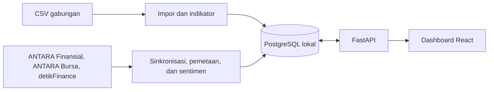

# Arsitektur MVP

[Requirement produk dan hasil validasi sumber](requirements.md) menjadi acuan cakupan desain ini.

React dan Vite mengelola dashboard dengan Lightweight Charts untuk candlestick, garis band, dan histogram volume. Backend Python menggunakan FastAPI dan model Pydantic. PostgreSQL menyimpan harga dan berita sejak tahap pertama, dengan SQLAlchemy untuk akses data serta Alembic untuk migrasi skema. Untuk demo, satu worker Uvicorn di loopback menyajikan hasil build React dan API dari alamat yang sama serta menjalankan sinkronisasi berita selama aplikasi aktif.

## Struktur

```text
web-stock-analyzer/
├── app/
│   ├── market/
│   ├── news/
│   └── web/
├── frontend/
│   └── src/
│       └── features/
│           ├── market/
│           └── news/
├── tests/
│   └── fixtures/
├── data/
└── docs/
```

| Direktori | Tanggung jawab |
|---|---|
| `app/market/` | Validasi dan impor CSV, histori OHLCV, serta Bollinger Bands. |
| `app/news/` | Sinkronisasi RSS, deduplikasi, pemetaan emiten, dan label sentimen. |
| `frontend/` | Dashboard React dan aset chart lokal. Komponen induk menyimpan emiten aktif, rentang tanggal, dan candle terpilih. Pergantian emiten mengosongkan pilihan candle sebelumnya. |
| `app/web/` | Route FastAPI, skema respons Pydantic, siklus hidup sinkronisasi, dan penyajian hasil build React. |
| `tests/` | Pengujian backend dan contoh CSV atau respons RSS kecil untuk menguji impor serta sinkronisasi secara berulang. |
| `data/` | CSV sumber untuk impor histori di laptop presentasi. |

Saat implementasi, `app/web/main.py` merangkai router harga dan berita dengan `APIRouter`. Router memanggil `app/market` atau `app/news`. Kedua paket dapat diuji langsung tanpa menjalankan server HTTP. Akses penyimpanan per fitur ditempatkan bersama fitur tersebut.

Di frontend, `src/App.jsx` akan mengoordinasikan emiten, rentang, dan candle terpilih. `src/features/market/` menampung pemilih emiten, filter tanggal, chart, dan detail candle. `src/features/news/` menampung daftar berita dan status feed. Vite memakai `frontend/index.html` sebagai titik masuk HTML dan menghasilkan build di `frontend/dist/`.

Pembagian ini mengikuti pola paket dan router FastAPI serta hierarki komponen dan pengelolaan state bersama di React. Direktori dikelompokkan menurut fitur agar kode yang berubah bersama mudah ditemukan. [FastAPI Bigger Applications](https://fastapi.tiangolo.com/tutorial/bigger-applications/) · [Thinking in React](https://react.dev/learn/thinking-in-react) · [Vite Project Root](https://vite.dev/guide/#index-html-and-project-root)

## Aliran data



### Harga

Validasi skema, nilai OHLCV, dan keunikan pasangan emiten dan tanggal sebelum menulis data dalam satu transaksi. Impor ulang CSV yang sama mempertahankan jumlah baris. Simpan OHLC, Adj Close, dan volume. Hitung SMA 20 sesi dan band pada ±2 standar deviasi sampel dari Close per emiten. Lakukan perhitungan sebelum filter tampilan. Band bernilai `null` selama jendela belum memiliki 20 sesi.

Tampilkan satu emiten dengan rentang bawaan tiga bulan dari tanggal terakhir data. Klik candle membuka detail OHLC, band, dan volume. Tampilkan tanggal harga terbaru dari data yang tersimpan.

### Berita

Baca [ANTARA Finansial](https://www.antaranews.com/rss/ekonomi-finansial.xml), [ANTARA Bursa](https://www.antaranews.com/rss/ekonomi-bursa.xml), dan [detikFinance](https://finance.detik.com/rss). FastAPI mengelola loop sinkronisasi melalui lifespan. Jadwalkan pemeriksaan pertama saat startup tanpa menahan respons dashboard. Ulangi selama aplikasi aktif dengan interval awal 15 menit sesuai ketentuan sumber, cegah putaran tumpang tindih, dan hentikan loop saat shutdown. Validasi izin penyimpanan dan penayangan metadata sebelum integrasi.

Simpan judul, sumber, URL, waktu publikasi, dan waktu pengambilan. Gunakan URL kanonis untuk menyatukan artikel lintas kanal. Simpan relasi artikel dengan emiten yang cocok dan label sentimen per relasi. Artikel dengan konteks kurang tampil sebagai **Belum dinilai**. Kegagalan satu feed mempertahankan artikel tersimpan dan status terakhir per feed. Feed lain tetap diproses.

Panel berita terbaru mengikuti emiten dan dapat memuat berita setelah batas CSV. Saat candle dipilih, gunakan jendela setelah penutupan sesi sebelumnya hingga penutupan sesi terpilih berdasarkan jadwal bursa. Jika batas sesi atau cakupan arsip belum tersedia, tampilkan status konteks sesi belum tersedia. Konversikan waktu publikasi ke WIB untuk tampilan.

## Penyimpanan PostgreSQL

FastAPI membaca koneksi PostgreSQL dari `DATABASE_URL`. Jalankan migrasi Alembic sebelum impor CSV pertama atau saat versi skema berubah. Untuk demo, jalankan PostgreSQL di laptop presentasi agar histori dan berita tersimpan dapat dibuka tanpa internet.

| Tabel | Kunci dan isi |
|---|---|
| `prices` | Pasangan emiten dan tanggal sesi. OHLC, harga penutupan tersesuaikan, dan volume. |
| `articles` | URL kanonis unik. Judul, tautan asli, penerbit, waktu publikasi dan pengambilan dalam UTC, serta cuplikan jika diizinkan. |
| `article_tickers` | Pasangan artikel dan emiten. Label sentimen terhadap emiten terkait. |
| `feed_status` | ID feed. Waktu percobaan dan keberhasilan terakhir, status, dan waktu pengamatan awal untuk menjelaskan keterbatasan arsip. |

Unduh dan parse respons feed sebelum membuka transaksi tulis. Simpan artikel dan relasi dalam transaksi singkat. Simpan hasil pengambilan sebelum klasifikasi agar artikel tetap bisa dibuka saat penilaian sentimen tertunda. Endpoint hanya membaca hasil yang tersimpan.

## Kontrak API awal

| Endpoint | Respons |
|---|---|
| `GET /api/tickers` | Kode dan nama empat bank serta tanggal awal dan akhir harga yang tersedia per emiten. |
| `GET /api/market/{ticker}?start=&end=` | Candlestick terurut, volume, dan tiga nilai band. Parameter tanggal opsional, berformat ISO dan inklusif. |
| `GET /api/news/{ticker}` | Berita terbaru, waktu publikasi, label sentimen, dan cakupan arsip yang diketahui. |
| `GET /api/news/{ticker}?session_date=` | Berita dalam jendela sesi yang dipilih dan status cakupan. Bedakan respons kosong dari konteks sesi yang belum tersedia. |
| `GET /api/feeds/status` | Waktu dan status sinkronisasi per feed. |

Pydantic memvalidasi parameter dan bentuk respons. Emiten tak dikenal menghasilkan 404. Tanggal tak valid atau rentang terbalik menghasilkan 422. Rentang harga valid tanpa data menghasilkan daftar kosong. Frontend mengabaikan respons lama ketika emiten atau rentang sudah berubah.

## Pengembangan dan demo

- **Pengembangan.** Vite menyajikan React dan meneruskan permintaan `/api` ke FastAPI.
- **Demo.** Jalankan PostgreSQL lokal, terapkan migrasi, dan pastikan CSV sudah diimpor. Build React ke `frontend/dist/`, lalu jalankan Uvicorn dengan satu worker pada alamat lokal. FastAPI melayani halaman dan aset hasil build. Aset chart disertakan dalam build agar histori dan berita tersimpan dapat dibuka saat koneksi internet terputus.

## Verifikasi demo

1. Buka dashboard lokal, pilih BBCA, dan telusuri 2018–2020. Ubah rentang dan pastikan nilai band pada tanggal yang sama konsisten.
2. Ganti emiten dan pastikan chart serta berita mengikuti pilihan.
3. Buktikan sinkronisasi RSS dari sumber asli, periksa tautan dan label artikel, lalu sinkronkan ulang untuk memeriksa duplikat.
4. Simulasikan satu feed gagal dan pastikan cache berita dan status per sumber tampil.
5. Buka hasil build dari FastAPI dengan internet terputus. Pastikan chart, histori, dan artikel yang tersimpan dapat ditampilkan.

Pembaruan harga setelah 8 Oktober 2026, candle sesi berjalan, media sosial, dan hosting dicatat untuk tahap lanjutan.
