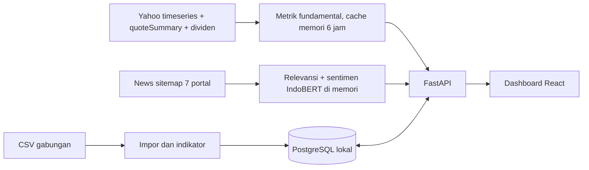

# Arsitektur MVP

[Requirement produk dan hasil validasi sumber](requirements.md) menjadi acuan cakupan desain ini.

React dan Vite mengelola dashboard dengan Lightweight Charts untuk candlestick, garis band, dan histogram volume. Backend Python menggunakan FastAPI dan model Pydantic. PostgreSQL menyimpan harga dan berita sejak tahap pertama, dengan SQLAlchemy untuk akses data serta Alembic untuk migrasi skema. Untuk demo, satu worker Uvicorn di loopback menyajikan hasil build React dan API dari alamat yang sama serta menjalankan sinkronisasi berita selama aplikasi aktif.

## Struktur

```text
web-stock-analyzer/
├── app/
│   ├── market/
│   ├── news/
│   └── web/
├── frontend/
│   └── src/
│       └── features/
│           ├── market/
│           └── news/
├── tests/
│   └── fixtures/
├── data/
└── docs/
```

| Direktori | Tanggung jawab |
|---|---|
| `app/market/` | Validasi dan impor CSV, histori OHLCV, serta Bollinger Bands. |
| `app/news/` | Pemantauan berita live dari news sitemap 7 portal, relevansi per emiten, dan sentimen IndoBERT, semuanya di memori (tanpa database). |
| `frontend/` | Dashboard React dan aset chart lokal. Komponen induk menyimpan emiten aktif, rentang tanggal, dan candle terpilih. Pergantian emiten mengosongkan pilihan candle sebelumnya. |
| `app/web/` | Route FastAPI, skema respons Pydantic, siklus hidup sinkronisasi, dan penyajian hasil build React. |
| `tests/` | Pengujian backend, contoh CSV kecil, serta sitemap dan artikel tiruan untuk menguji pemantauan berita tanpa internet. |
| `data/` | CSV sumber untuk impor histori di laptop presentasi. |

Saat implementasi, `app/web/main.py` merangkai router harga dan berita dengan `APIRouter`. Router memanggil `app/market` atau `app/news`. Kedua paket dapat diuji langsung tanpa menjalankan server HTTP. Akses penyimpanan per fitur ditempatkan bersama fitur tersebut.

Di frontend, `src/App.jsx` akan mengoordinasikan emiten, rentang, dan candle terpilih. `src/features/market/` menampung pemilih emiten, filter tanggal, chart, dan detail candle. `src/features/news/` menampung daftar berita dan status feed. Vite memakai `frontend/index.html` sebagai titik masuk HTML dan menghasilkan build di `frontend/dist/`.

Pembagian ini mengikuti pola paket dan router FastAPI serta hierarki komponen dan pengelolaan state bersama di React. Direktori dikelompokkan menurut fitur agar kode yang berubah bersama mudah ditemukan. [FastAPI Bigger Applications](https://fastapi.tiangolo.com/tutorial/bigger-applications/) · [Thinking in React](https://react.dev/learn/thinking-in-react) · [Vite Project Root](https://vite.dev/guide/#index-html-and-project-root)

## Aliran data



### Harga

Sumber utama adalah endpoint chart Yahoo Finance untuk simbol `.JK` (`app/market/yahoo.py`, `app/market/sync.py`). Sinkronisasi berjalan lewat lifespan saat startup lalu tiap jam, berurutan per emiten dengan jeda 1 detik. Hari libur bursa (candle datar bervolume 0) dibuang, High/Low yang tidak konsisten dikoreksi, dan candle hari ini baru disimpan setelah 16.15 WIB. Setiap emiten diganti seluruh serinya dalam satu transaksi; respons yang jauh lebih pendek dari data tersimpan ditolak. Status per emiten disimpan di `price_sync_status`. CSV tetap bisa diimpor sebagai cadangan tanpa internet.

Validasi skema, nilai OHLCV, dan keunikan pasangan emiten dan tanggal sebelum menulis data dalam satu transaksi. Impor ulang CSV yang sama mempertahankan jumlah baris. Simpan OHLC, Adj Close, dan volume. Hitung SMA 20 sesi dan band pada ±2 standar deviasi sampel dari Close per emiten. Lakukan perhitungan sebelum filter tampilan. Band bernilai `null` selama jendela belum memiliki 20 sesi.

Tampilkan satu emiten dengan rentang bawaan tiga bulan dari tanggal terakhir data. Klik candle membuka detail OHLC, band, dan volume. Tampilkan tanggal harga terbaru dari data yang tersimpan.

### Berita

Berita dipantau live dan **tidak disimpan ke database** (`app/news/live.py`). FastAPI menjalankan putaran pemantauan lewat lifespan: saat startup, lalu tiap 5 menit, tanpa putaran tumpang tindih. Setiap putaran membaca news sitemap CNBC Indonesia, Kontan, Katadata, Kompas Money, detikFinance, CNN Indonesia, dan Infobank (portal lain menolak akses otomatis atau hanya dapat diakses sebagian). Judul disaring dulu; hanya artikel kandidat yang diunduh dengan menghormati robots.txt dan jeda per domain. Isi diekstrak, relevansi per emiten ditentukan dengan aturan yang sama dengan pengumpul dataset, lalu model IndoBERT lokal menilai sentimen dari kalimat yang menyebut emiten tersebut.

Hasil disimpan di memori proses selama 7 hari, lalu dibuang. Teks artikel hanya dipegang sampai sentimennya dinilai. Model dimuat di thread latar; artikel yang masuk sebelum model siap dinilai pada putaran berikutnya. Kegagalan satu portal tidak menghentikan portal lain, dan status per portal tampil di dashboard.

Panel berita mengikuti emiten aktif. Saat candle dipilih, gunakan jendela setelah penutupan sesi sebelumnya (16.00 WIB) sampai penutupan sesi terpilih. Karena berita hanya ada sejak server berjalan, sesi lama menampilkan status konteks belum tersedia.

### Fundamental

Metrik fundamental diambil dari Yahoo Finance saat panel dibuka (`app/fundamental/`) dan hanya di-cache di memori selama 6 jam; tidak ada yang ditulis ke database. Tiga sumber dipakai: endpoint fundamentals-timeseries untuk laporan keuangan (kuartalan, tahunan, TTM), quoteSummary untuk harga terkini, saham beredar, free float, forward EPS, dan ex date terjadwal, serta event dividen dari endpoint chart untuk dividen TTM. Laporan keuangan sengaja hanya dari timeseries agar definisinya konsisten; modul `financialData` di quoteSummary memakai definisi lain. Field `trailingAnnualDividendRate` tidak dipakai karena kadang 0 walau dividen sudah dibagikan.

Semua rasio dihitung di `app/fundamental/metrics.py` (fungsi murni, diuji dengan fixture BBCA). Annualised = total kuartal tahun berjalan x 4 / jumlah kuartal. Kelipatan valuasi tidak dihitung bila penyebutnya negatif. Pertumbuhan YoY kuartal dan YTD hanya dihitung bila kuartal pembanding ada; Yahoo hanya menyediakan sekitar lima kuartal terakhir dan kadang melompati satu kuartal. Rasio regulasi bank (NPL, CAR, CASA, NIM, cost of credit) tidak tersedia di Yahoo, dan rasio untuk perusahaan nonbank (gross margin, current/quick ratio, DSO/DIO/DPO, EV/EBITDA, ROCE, ROIC) tidak ditampilkan karena tidak bermakna untuk bank. Daftar ini juga tampil di dashboard. Bila Yahoo gagal, data terakhir disajikan dengan status `stale`.

## Penyimpanan PostgreSQL

FastAPI membaca koneksi PostgreSQL dari `DATABASE_URL`. Jalankan migrasi Alembic sebelum impor CSV pertama atau saat versi skema berubah. Untuk demo, jalankan PostgreSQL di laptop presentasi agar histori dan berita tersimpan dapat dibuka tanpa internet.

| Tabel | Kunci dan isi |
|---|---|
| `prices` | Pasangan emiten dan tanggal sesi. OHLC, harga penutupan tersesuaikan, dan volume. |
| `price_sync_status` | Emiten. Status, waktu percobaan dan keberhasilan terakhir, sesi final terakhir, serta jumlah hari libur yang dibuang dan baris yang dikoreksi. |

PostgreSQL hanya menyimpan histori harga dan status sinkronisasi harga. Berita dan sentimen tidak pernah ditulis ke database (migrasi `0003` menghapus tabel berita lama).

## Kontrak API awal

| Endpoint | Respons |
|---|---|
| `GET /api/tickers` | Kode dan nama empat bank serta tanggal awal dan akhir harga yang tersedia per emiten. |
| `GET /api/market/{ticker}?start=&end=` | Candlestick terurut, volume, dan tiga nilai band. Parameter tanggal opsional, berformat ISO dan inklusif. |
| `GET /api/news/{ticker}` | Berita terbaru, waktu publikasi, label sentimen, dan cakupan arsip yang diketahui. |
| `GET /api/news/{ticker}?session_date=` | Berita dalam jendela sesi yang dipilih dan status cakupan. Bedakan respons kosong dari konteks sesi yang belum tersedia. |
| `GET /api/feeds/status` | Waktu dan status sinkronisasi per feed. |
| `POST /api/feeds/sync` | Picu satu putaran sinkronisasi berita (demo). |
| `GET /api/prices/status` | Status pengambilan harga Yahoo per emiten. |
| `POST /api/prices/sync` | Picu satu putaran pengambilan harga. |
| `GET /api/fundamentals/{ticker}?refresh=` | Metrik fundamental per kelompok, tabel per periode, pertumbuhan, dan riwayat dividen. `refresh=true` mengabaikan cache. Status `ok`, `stale`, atau `unavailable`. |

Pydantic memvalidasi parameter dan bentuk respons. Emiten tak dikenal menghasilkan 404. Tanggal tak valid atau rentang terbalik menghasilkan 422. Rentang harga valid tanpa data menghasilkan daftar kosong. Frontend mengabaikan respons lama ketika emiten atau rentang sudah berubah.

## Pengembangan dan demo

- **Pengembangan.** Vite menyajikan React dan meneruskan permintaan `/api` ke FastAPI.
- **Demo.** Jalankan PostgreSQL lokal, terapkan migrasi, dan pastikan CSV sudah diimpor. Build React ke `frontend/dist/`, lalu jalankan Uvicorn dengan satu worker pada alamat lokal. FastAPI melayani halaman dan aset hasil build. Aset chart disertakan dalam build agar histori dan berita tersimpan dapat dibuka saat koneksi internet terputus.

## Verifikasi demo

1. Buka dashboard lokal, pilih BBCA, dan telusuri 2018–2020. Ubah rentang dan pastikan nilai band pada tanggal yang sama konsisten.
2. Ganti emiten dan pastikan chart serta berita mengikuti pilihan.
3. Tekan **Cek berita sekarang**, periksa tautan, label sentimen, dan persentase keyakinan artikel dari portal asli; putaran ulang tidak menambah duplikat.
4. Simulasikan satu feed gagal dan pastikan cache berita dan status per sumber tampil.
5. Buka hasil build dari FastAPI dengan internet terputus. Pastikan chart, histori, dan artikel yang tersimpan dapat ditampilkan.

Pembaruan harga setelah 8 Oktober 2026, candle sesi berjalan, media sosial, dan hosting dicatat untuk tahap lanjutan.
